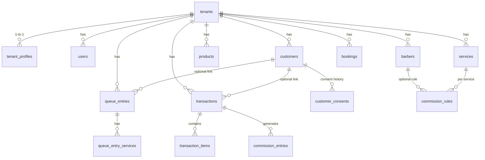

# BarberFlow — Skema Database

> **Database:** PostgreSQL 16  
> **Multi-tenancy:** `tenant_id` pada setiap tabel operational + Row-Level Security (RLS)  
> **Role DB:** `barberflow_owner` (DDL), `barberflow_app` (DML tenant-scoped), `barberflow_platform` (DML super_admin)

---

## Arsitektur Keamanan DB

```
barberflow_owner    → bisa DDL, bypass RLS (migration runner)
barberflow_app      → DML; RLS membatasi ke tenant_id = current_setting('app.tenant_id')
barberflow_platform → hanya INSERT ke tenants/tenant_profiles/receipt_counters/users (owner baru)
                      + EXECUTE app_private.platform_tenant_stats()
                      TIDAK ada grant ke tabel customers, transactions, dll.
```

**RLS Pattern:**
```sql
-- Setiap transaksi DB set dulu:
SELECT set_config('app.tenant_id', '<uuid>', true);  -- true = transaction-local only
-- Semua query berikutnya di-filter otomatis oleh policy ini:
USING (tenant_id = app_private.current_tenant_id())
```

---

## Diagram ERD (Ringkas)



---

## Tabel Platform

### `tenants`
| Kolom | Tipe | Keterangan |
|-------|------|-----------|
| `id` | uuid PK | Auto `gen_random_uuid()` |
| `name` | text | Nama barbershop (2–120 char) |
| `slug` | text UNIQUE | URL-friendly, 3–50 char lowercase+angka+dash |
| `plan` | text | `starter` \| `pro` |
| `feature_flags` | jsonb | Override boolean per fitur |
| `is_active` | boolean | Nonaktif = semua user tidak bisa login |
| `created_at` | timestamptz | |

### `tenant_profiles`
| Kolom | Tipe | Keterangan |
|-------|------|-----------|
| `tenant_id` | uuid PK FK→tenants | |
| `address` | text | |
| `phone` | text | |
| `receipt_footer` | text | Teks penutup struk (maks 200 char) |
| `paper_width_mm` | smallint | `58` atau `80` |
| `open_time` | time | Jam buka (default 09:00) |
| `close_time` | time | Jam tutup (default 21:00) |
| `logo_url` | text | Opsional |
| `updated_at` | timestamptz | |

### `users`
| Kolom | Tipe | Keterangan |
|-------|------|-----------|
| `id` | uuid PK | |
| `tenant_id` | uuid FK→tenants | NULL hanya untuk `super_admin` |
| `email` | text | Unik (case-insensitive) |
| `password_hash` | text | Argon2id |
| `full_name` | text | 2–120 char |
| `role` | text | `owner` \| `cashier` \| `barber` \| `super_admin` |
| `is_active` | boolean | |
| `created_by_platform` | boolean | Dibuat oleh super_admin |
| `created_at` | timestamptz | |

> **Constraint:** `super_admin` → `tenant_id IS NULL`; semua role lain → `tenant_id IS NOT NULL`.

---

## Tabel Master Data (tenant-scoped, RLS aktif)

### `barbers`
| Kolom | Tipe | Keterangan |
|-------|------|-----------|
| `id` | uuid PK | |
| `tenant_id` | uuid FK→tenants | |
| `user_id` | uuid FK→users NULL | Link ke akun user (opsional) |
| `display_name` | text | 2–80 char |
| `phone` | text | Opsional |
| `photo_url` | text | Opsional |
| `skills` | text[] | Daftar keahlian |
| `is_active` | boolean | |
| Composite UQ | `(tenant_id, id)` | Untuk cross-table FK yang aman antar-tenant |

### `services`
| Kolom | Tipe | Keterangan |
|-------|------|-----------|
| `id` | uuid PK | |
| `tenant_id` | uuid FK→tenants | |
| `name` | text | 2–80 char, unik per tenant |
| `price_idr` | integer | Dalam Rupiah (IDR), ≥ 0 |
| `duration_minutes` | smallint | 5–480 menit |
| `description` | text | |
| `is_active` | boolean | |
| Composite UQ | `(tenant_id, id)` | |

### `products`
| Kolom | Tipe | Keterangan |
|-------|------|-----------|
| `id` | uuid PK | |
| `tenant_id` | uuid FK→tenants | |
| `name` | text | 2–80 char, unik per tenant |
| `price_idr` | integer | ≥ 0 |
| `stock_quantity` | integer | ≥ 0 |
| `is_active` | boolean | |
| Composite UQ | `(tenant_id, id)` | |

---

## Tabel Operasional

### `receipt_counters`
| Kolom | Tipe | Keterangan |
|-------|------|-----------|
| `tenant_id` | uuid PK FK→tenants | |
| `last_number` | bigint | Nomor struk terakhir, di-increment dengan `SELECT ... FOR UPDATE` |

### `queue_counters`
| Kolom | Tipe | Keterangan |
|-------|------|-----------|
| `tenant_id` | uuid FK→tenants | |
| `queue_date` | date | |
| `last_number` | integer | Nomor antrean terakhir hari itu |
| PK | `(tenant_id, queue_date)` | |

### `queue_entries`
| Kolom | Tipe | Keterangan |
|-------|------|-----------|
| `id` | uuid PK | |
| `tenant_id` | uuid FK→tenants | |
| `queue_date` | date | |
| `queue_number` | integer | Nomor antrean (unik per tenant+tanggal) |
| `customer_id` | uuid FK→customers NULL | Link ke pelanggan (opsional) |
| `customer_name` | text | Snapshot nama saat daftar |
| `barber_id` | uuid FK→barbers NULL | |
| `status` | text | `waiting` \| `in_service` \| `done` \| `cancelled` |
| `created_at` | timestamptz | |
| `updated_at` | timestamptz | |

### `queue_entry_services`
Layanan yang akan dikerjakan untuk satu antrean (many-to-many).

### `transactions`
| Kolom | Tipe | Keterangan |
|-------|------|-----------|
| `id` | uuid PK | |
| `tenant_id` | uuid FK→tenants | |
| `receipt_number` | bigint | Nomor struk final dari server (unik per tenant) |
| `temp_receipt_ref` | text | Nomor sementara dari perangkat saat offline |
| `idempotency_key` | text | 16–100 char, unik per tenant — cegah duplikat saat sinkronisasi |
| `customer_id` | uuid FK→customers NULL | |
| `barber_id` | uuid FK→barbers NULL | |
| `queue_entry_id` | uuid FK→queue_entries NULL | |
| `subtotal_idr` | integer | ≥ 0 |
| `discount_type` | text | `none` \| `percent` \| `fixed` |
| `discount_value` | numeric(10,2) | Nilai diskon (persen atau Rupiah) |
| `discount_idr` | integer | Nominal diskon dalam Rupiah |
| `total_idr` | integer | Harus = `subtotal_idr - discount_idr` (CHECK constraint) |
| `payment_method` | text | `cash` \| `qris` \| `transfer` |
| `created_by` | uuid FK→users NULL | |
| `occurred_at` | timestamptz | Waktu transaksi |
| `public_token_hash` | text UNIQUE | SHA-256 dari token publik (token asli tidak disimpan) |

### `transaction_items`
| Kolom | Tipe | Keterangan |
|-------|------|-----------|
| `id` | uuid PK | |
| `tenant_id` | uuid FK→tenants | |
| `transaction_id` | uuid FK→transactions | |
| `position` | smallint | Urutan tampil di struk |
| `kind` | text | `service` \| `product` |
| `service_id` | uuid FK→services NULL | |
| `product_id` | uuid FK→products NULL | |
| `name_snapshot` | text | Nama saat transaksi (tidak berubah walau nama layanan diubah) |
| `unit_price_idr` | integer | ≥ 0 |
| `quantity` | integer | 1–999 |
| `line_total_idr` | integer | Harus = `unit_price_idr × quantity` (CHECK constraint) |

---

## Tabel Pelanggan & Consent

### `customers`
| Kolom | Tipe | Keterangan |
|-------|------|-----------|
| `id` | uuid PK | |
| `tenant_id` | uuid FK→tenants | |
| `name` | text | 1–120 char |
| `phone` | text | Opsional, 8–16 digit |
| `hair_preference` | text | Preferensi gaya potongan |
| `favorite_barber_id` | uuid FK→barbers NULL | |
| `notes` | text | |
| `created_at` | timestamptz | |

### `customer_consents` (append-only)
Riwayat persetujuan sesuai UU PDP. Status terkini = baris terbaru per `(customer_id, purpose)`.

| Kolom | Tipe | Keterangan |
|-------|------|-----------|
| `id` | bigint PK | Auto identity |
| `tenant_id` | uuid FK→tenants | |
| `customer_id` | uuid FK→customers | |
| `purpose` | text | `data_processing` \| `whatsapp_reminder` |
| `is_granted` | boolean | |
| `recorded_by` | uuid FK→users NULL | |
| `recorded_at` | timestamptz | |

---

## Tabel Komisi

### `commission_rules`
| Kolom | Tipe | Keterangan |
|-------|------|-----------|
| `id` | uuid PK | |
| `tenant_id` | uuid FK→tenants | |
| `service_id` | uuid FK→services | |
| `barber_id` | uuid FK→barbers NULL | NULL = aturan default semua kapster |
| `type` | text | `percent` \| `fixed` |
| `value` | numeric(12,2) | Persentase (≤100) atau nominal Rupiah |
| Unique | `(tenant_id, service_id, COALESCE(barber_id, '00000000-...')` | |

### `commission_entries` (append-only, tidak bisa UPDATE/DELETE oleh app)
| Kolom | Tipe | Keterangan |
|-------|------|-----------|
| `id` | uuid PK | |
| `tenant_id` | uuid FK→tenants | |
| `transaction_id` | uuid FK→transactions | |
| `transaction_item_id` | uuid FK→transaction_items UNIQUE | Satu entri per item |
| `barber_id` | uuid FK→barbers | |
| `amount_idr` | integer | ≥ 0 |
| `rule_snapshot` | jsonb | Snapshot aturan saat transaksi (audit trail) |
| `created_at` | timestamptz | |

---

## Tabel Lainnya

### `expenses`
Pengeluaran manual yang dicatat owner.

### `whatsapp_usage`
Kuota WhatsApp per tenant per bulan (`month` = tanggal 1 bulan tersebut).

### `whatsapp_messages`
Log pesan WhatsApp (status: `stubbed` / `sent` / `failed`).

### `bookings`
Booking online. Anti-overlap dijamin oleh exclusion constraint PostgreSQL (`btree_gist`):
```sql
CONSTRAINT bookings_no_overlap EXCLUDE USING gist (
  tenant_id WITH =, barber_id WITH =, tstzrange(starts_at, ends_at) WITH &&
) WHERE (status = 'booked')
```

### `audit_logs`
Append-only. App role tidak bisa UPDATE atau DELETE.

---

## Fungsi SECURITY DEFINER (di schema `app_private`)

| Fungsi | Caller | Tujuan |
|--------|--------|--------|
| `find_user_for_login(email)` | `barberflow_app` | Login tanpa membuka tabel users langsung |
| `session_is_valid(user_id)` | `barberflow_app` | Cek user + tenant masih aktif per request |
| `tenant_by_slug(slug)` | `barberflow_app` | Resolve slug untuk booking publik |
| `get_public_receipt(token_hash)` | `barberflow_app` | Struk publik — tidak termasuk nomor telepon pelanggan |
| `platform_tenant_stats()` | `barberflow_platform` | Statistik agregat untuk super_admin |

---

## Catatan Penting

1. **Nomor struk:** Di-generate server dengan `SELECT last_number+1 FROM receipt_counters WHERE tenant_id=$1 FOR UPDATE` di dalam satu transaksi DB. Nomor sementara offline disimpan di `temp_receipt_ref`.
2. **Idempotency:** `UNIQUE (tenant_id, idempotency_key)` di tabel `transactions` — sinkronisasi offline tidak bisa buat duplikat.
3. **Token publik struk:** Hanya hash SHA-256 yang disimpan di DB. Token asli dikirim sekali ke klien, tidak bisa di-recover dari DB.
4. **super_admin:** Role `barberflow_platform` tidak punya grant ke tabel `customers`, `transactions`, `transaction_items`, `commission_entries`, dll. Pemisahan dijamin di level DB, bukan hanya di level aplikasi.

